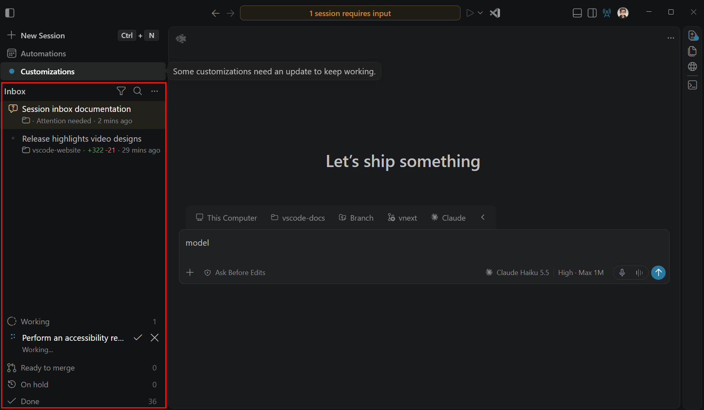
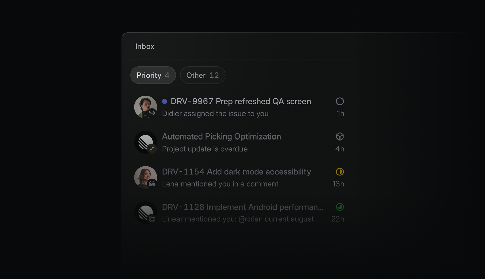
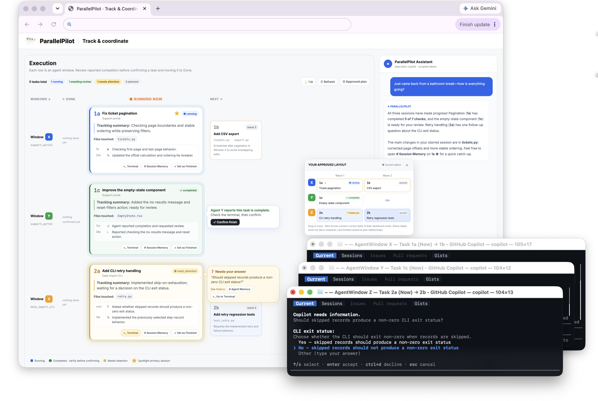
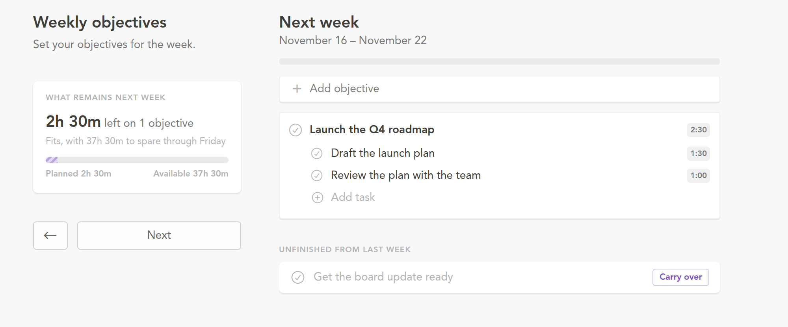
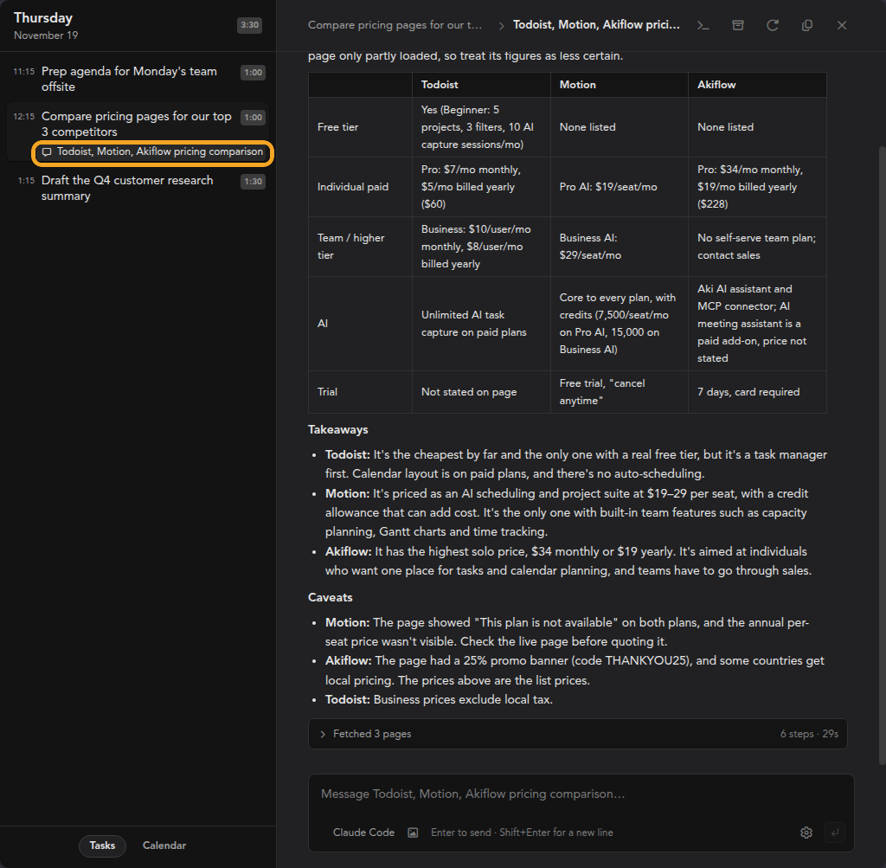
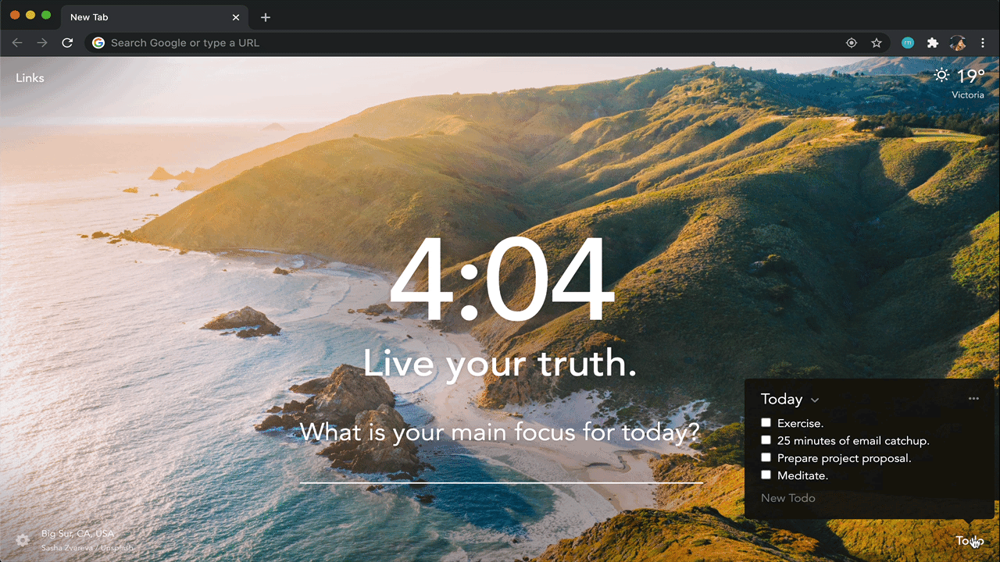
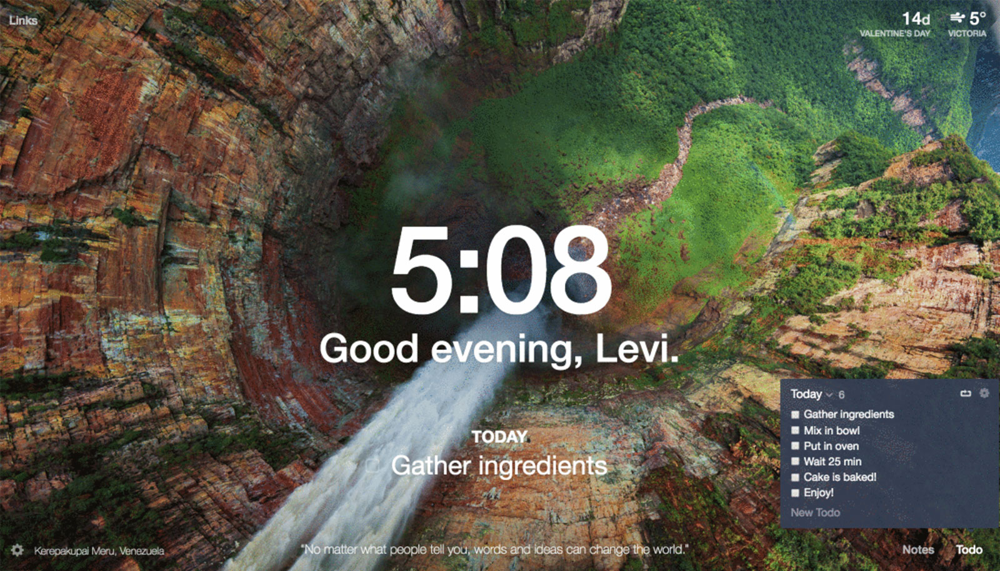

# Product precedents for a priority inbox

2026-11-21 · Documented behavior and public screenshots

## Inboxes, markers, and follow-up

| Product | How it handles attention |
| --- | --- |
| **Gmail** | A star is a manual marker. On desktop, users can enable more colors and symbols and cycle through them. Search can match any star or a specific marker. Priority Inbox can display Important and unread, Starred, and Everything else, with configurable sections. Gmail infers importance from behavior, gives an explanation on hover, and accepts corrections. Starring can inform the importance signal, while each marker remains independently usable. [Stars](https://support.google.com/mail/answer/5904?hl=en) · [Layouts](https://support.google.com/mail/answer/18522?hl=en) · [Importance markers](https://support.google.com/mail/answer/186543?hl=en) |
| **Inbox by Gmail and Gmail AI Inbox** | The retired Inbox by Gmail grouped related messages in bundles and supported reminders and snooze. Gmail's separate AI Inbox beta groups suggested actions above updates to catch up on and links suggestions to source messages. The distinction is between action and awareness. [Inbox introduction](https://blog.google/products-and-platforms/products/gmail/an-inbox-that-works-for-you/) · [Sunset announcement](https://blog.google/products-and-platforms/products/gmail/inbox-signing-find-your-favorite-features-new-gmail/) · [AI Inbox beta](https://support.google.com/mail/answer/16845247?hl=en) |
| **Outlook** | Focused and Other are separate tabs. A correction can move one message or direct future messages from that sender. Flagging is a different action. On supported accounts, flagged messages appear as tasks in Microsoft To Do. [Focused Inbox](https://support.microsoft.com/en-us/outlook/mail/focused-inbox-for-outlook) · [Flagged mail in To Do](https://support.microsoft.com/en-us/todo/using-microsoft-to-do-with-flagged-email-from-outlook) |
| **Superhuman** | Split Inbox makes named queues with counts, such as Important, VIP, and Other. Each extra tab offers a narrower view and adds another place to check. Remind Me removes a conversation until a set time, with an option to cancel the reminder on reply. [Split Inbox](https://help.superhuman.com/hc/en-us/articles/46005619081101-Default-Split-Inbox) · [Remind Me](https://help.superhuman.com/hc/en-us/articles/46005666142733-Remind-Me) |
| **Linear** | Inbox has Priority and Other tabs. Users choose which notifications qualify and can search by project, team, or notification reason. My Issues groups assigned work by conditions such as urgency or blockers and orders within groups by priority. Favorites are personal shortcuts to issues, projects, and views. [Inbox](https://linear.app/docs/inbox) · [My Issues](https://linear.app/docs/my-issues) · [Favorites](https://linear.app/docs/favorites) |
| **GitHub Notifications** | Read records that the notification was seen. Done clears it from the inbox. Save keeps it available in Saved. The same cross-repo inbox supports repository and reason filters, such as Review requested, and bulk triage. [Managing notifications](https://docs.github.com/en/subscriptions-and-notifications/how-tos/viewing-and-triaging-notifications/managing-notifications-from-your-inbox) |
| **Slack** | Saved items are private references. The To-dos rollout separates items with follow-up from references and gives To-dos completion and optional reminders. Channel and DM stars organize the sidebar. [Saved items](https://slack.com/intl/en-gb/help/articles/360042650274-Save-messages-and-files-for-later) · [To-dos rollout](https://slack.com/help/articles/55757634348435-Later-is-now-To-dos) · [Sidebar organization](https://slack.com/help/articles/360043207674-Organize-your-sidebar-with-custom-sections) |
| **Todoist** | Four colored priorities affect order in Today and Upcoming. Saved queries can combine project, priority, and date. Favorites are shortcuts. Weekly productivity goals count completed tasks. [Priority](https://www.todoist.com/help/todoist/features/set-a-priority-in-todoist-Wy82Jp) · [Filters](https://www.todoist.com/help/todoist/features/introduction-to-filters-V98wIH) · [Productivity goals](https://www.todoist.com/help/todoist/features/use-the-productivity-view-in-todoist-6S63uAa9) |

These products give a star, flag, or priority marker different jobs. Gmail's colored stars can be personal categories. Todoist colors encode fixed ranks. Linear favorites create shortcuts. GitHub Save preserves an item the user may need again. Copying the icon without choosing the job leaves the engineer guessing what a star will do.

## Agent work across projects

| Product or prototype | How it handles agent handoffs |
| --- | --- |
| **VS Code Agents Inbox** | The experimental Inbox prioritizes sessions with a question, approval, error, failing check, or result to review. Working, Ready to merge, On hold, Acknowledged, and Done provide other destinations. An acknowledgement clears current activity until there is something new. The inbox supports pins, snooze, and persisted workspace and environment scope. The opt-in welcome page surfaces recent sessions and a composer when no editors are restored. [Inbox behavior](https://code.visualstudio.com/docs/agents/run/sessions/organize-sessions#triage-sessions-with-inbox-mode) · [Release notes](https://code.visualstudio.com/updates/v1_147#_inbox-mode-improvements-experimental) · [Welcome page](https://code.visualstudio.com/docs/agents/run/chat-view#view-sessions-on-the-welcome-page) |
| **Sunsama Agent Threads** | The beta lets one task hold several agent conversations. Finished, stuck, and question states can flag attention, with amber status until the user opens the thread. Sunsama separately supports linking a task to a weekly objective. This establishes a path from conversation to outcome. Its docs describe the links and alerts without describing an inbox ranked by goal relevance. [Agent Threads](https://help.sunsama.com/docs/ai/agent-threads/) · [Weekly Objectives](https://help.sunsama.com/docs/usage-guides/weekly-objectives/) |
| **Codex app** | Project-scoped threads, worktrees, and diff review let one person work across independent changes. Later announcements describe suggestions for starting the day or picking up prior work from available context. [Codex app](https://openai.com/index/introducing-the-codex-app/) · [Suggestions announcement](https://openai.com/index/codex-for-almost-everything/) |
| **GitHub Agent Activity** | Issues and project items expose agent states such as queued, working, awaiting review, or complete. A repo-level Agents tab groups its sessions and supports archive and resumption. [Agent Activity](https://github.blog/changelog/2026-03-26-agent-activity-in-github-issues-and-projects/) · [Agents tab](https://github.blog/changelog/2026-01-26-introducing-the-agents-tab-in-your-repository/) |
| **ParallelPilot** | A research prototype places multiple running sessions in one dashboard. It surfaces requests for intervention and asks the human to confirm a finished result. A star spotlights the primary session, illustrating another meaning for the same icon. See the [research synthesis](research.md) for evaluation limits. [Project and screenshots](https://iamtaolong.github.io/project_pages/parallelpilot.html) |

## Weekly intent and a quiet home screen

| Product | What comes into view |
| --- | --- |
| **Momentum** | A new tab can repeat one user-written Daily Goal. A blank goal gives a lightweight inline prompt. Autofocus can instead show the top task from a selected list and advance when the user completes it. The chosen task stays in view each time the person returns. [Daily Goal](https://get.momentumdash.help/hc/en-us/articles/360012256274-Daily-Goal) · [Top task in center](https://get.momentumdash.help/hc/en-us/articles/360012372113-Top-task-in-center) |
| **Sunsama Weekly Objectives** | A weekly list holds outcomes with optional channels. Objectives appear alongside daily tasks. Tasks may be linked as they are created, and users can change the links. Carry-over is explicit and a review skips the objective step when there were no objectives. [Weekly Objectives](https://help.sunsama.com/docs/usage-guides/weekly-objectives/) · [Weekly Planning and Review](https://help.sunsama.com/docs/usage-guides/weekly-objectives/weekly-planning/) |
| **Things** | Today collects work across projects into one manually ordered list, with optional grouping by project or area. This Evening lets users defer work without removing it from Today. Upcoming shows the next seven days. [Things date views](https://culturedcode.com/things/support/articles/4001304/) |
| **Amazing Marvin** | Planning Ahead lets users place work in a week, month, or quarter independently of a daily schedule. Goals link projects and tasks. Super Focus shows one task at a time in the day's order. [Planning Ahead](https://help.amazingmarvin.com/amazing-marvin/planning-ahead) · [Goals](https://help.amazingmarvin.com/amazing-marvin/goals-objectives) · [Super Focus](https://help.amazingmarvin.com/amazing-marvin/super-focus-mode-sfm) |
| **Microsoft To Do** | My Day starts fresh and keeps unfinished tasks in their original lists. Suggestions are available for rebuilding the daily selection. [My Day and Suggestions](https://support.microsoft.com/en-gb/todo/my-day-and-suggestions) |
| **Full Focus Planner** | The Weekly Preview names three outcomes across the week. The Daily Big 3 draws from those outcomes and urgent work. Selection is manual. [Weekly and daily planning method](https://fullfocus.co/system/) |
| **Toby and Empty New Tab Page** | Toby restores context through tab collections and offers a manually ordered private Next list per workspace. Empty New Tab Page replaces Chrome's usual suggestions with a blank page. [Toby Collections](https://www.gettoby.com/collections) · [Toby Next](https://help.gettoby.com/support/solutions/articles/66000518451-toby-next) · [Empty New Tab Page](https://chromewebstore.google.com/detail/empty-new-tab-page/dpjamkmjmigaoobjbekmfgabipmfilij) |

## Screenshots

Sources are publisher or author images. They document layouts and examples, which can differ from current defaults and rollout availability.

### Attention queues

**VS Code** highlights sessions needing attention above Working. The source image uses relative timestamps on the thread rows. [Docs and original screenshot](https://code.visualstudio.com/docs/agents/run/sessions/organize-sessions#triage-sessions-with-inbox-mode)

**Linear** shows Priority and Other within one inbox. The selected tab determines which notifications are in view. [Launch notes and original screenshot](https://linear.app/changelog/2026-09-03-priority-inbox)

**ParallelPilot** gives a single engineer a dashboard for monitoring and triaging agents. [Authors' walkthrough and original screenshot](https://iamtaolong.github.io/project_pages/parallelpilot.html)

More visuals show how Gmail and Superhuman arrange different inbox sections. [Gmail inbox layouts](https://blog.google/products-and-platforms/products/gmail/gmail-inbox-types/) · [Gmail AI Inbox demo](https://support.google.com/mail/answer/16845247?hl=en) · [Superhuman's Split Inbox demo](https://storage.ghost.io/c/c7/8e/c78e4b36-4930-4765-917f-f40bc2da20ee/content/images/2023/05/Superhuman-Split-Inbox-7.gif)

### Returning to a goal

**Sunsama Weekly Planning** places upcoming objectives and carry-over together. [Docs and original screenshot](https://help.sunsama.com/docs/usage-guides/weekly-objectives/weekly-planning/)

**Sunsama Agent Threads** surfaces an agent's question inside its parent task. [Docs and original screenshot](https://help.sunsama.com/docs/ai/agent-threads/)

**Momentum Daily Goal** puts a single prompt below the clock when there is no goal. This still from the product demo uses earlier wording. [Original animation](https://content.momentumdash.com/blogimages/c83e2ed2-70b5-4bf9-bc40-f055210b873b) · [Current Daily Goal docs](https://get.momentumdash.help/hc/en-us/articles/360012256274-Daily-Goal)

**Momentum Autofocus** keeps one item from a list in view on the new-tab page. [Autofocus walkthrough and screenshot](https://momentumdash.com/blog/improve-your-productivity-with-autofocus)
